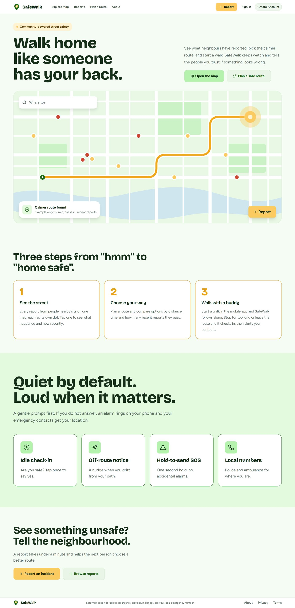
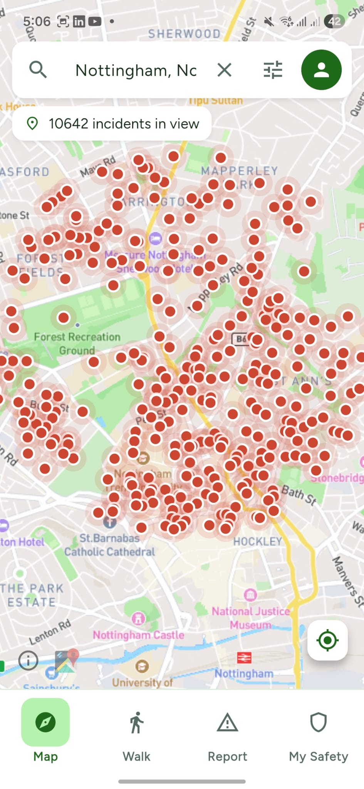
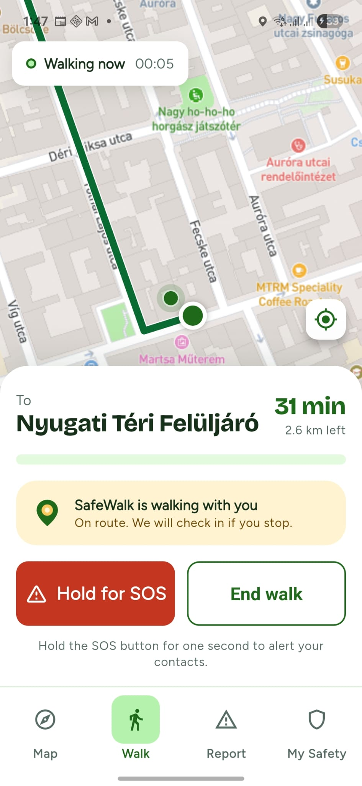
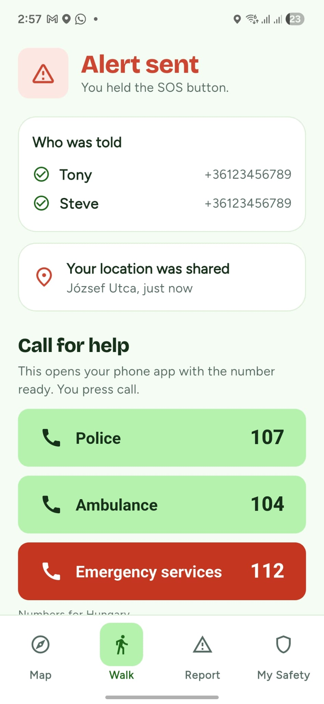
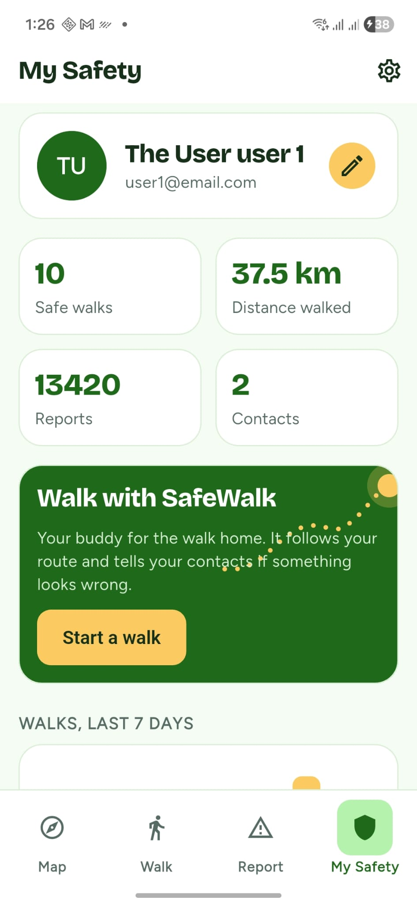

# SafeWalk

<!-- BADGES GO HERE -->

## 🛡️ About The Project
SafeWalk helps people get home safely. Neighbours report incidents, the reports become a live map, and a walk can be
tracked by a buddy that checks in and alerts trusted contacts if something looks wrong. It has three parts that share
one backend:

| Part | What it is | Folder |
|---|---|---|
| Backend | Spring Boot REST API: users, incident reports, routing, walk sessions, emergencies | [`backend`](backend) |
| Web app | Next.js site: map, reports, route planner, user dashboard and admin dashboard | [`frontend`](frontend) |
| Mobile app | Flutter Android app: map, route planner, reporting, walk sessions, SOS and alarms | [`mobile`](mobile) |

| | | | |
| --- | --- | --- | --- |
|  |  |  |  |

More screenshots are in the [web README](frontend/README.md) and the [mobile README](mobile/README.md).

### Key Features
*   **Routing Service:** Calculates optimized and secure route recommendations.
*   **Incident Reporting:** Allows users to submit, upvote, and track localized incidents (e.g., theft, hazards).
*   **Heatmap Generation:** Aggregates nearby incidents to visualize high-risk areas based on severity weights.
*   **Walk with a buddy:** Tracks a walk, asks "Are you safe?" when you stop, warns when you leave the route, and
    tells your emergency contacts if you do not answer.
*   **SOS and alarm:** Hold to send an alert with your location; the phone rings an alarm for warnings.
*   **Admin dashboard:** Manage users, reports, sessions and emergencies, with charts of platform activity.

---

## 💻 Tech Stack
*   **Backend:** Java 17
*   **Framework:** Spring Boot 4.0.5
*   **Database:** PostgreSQL (Production) / H2 (Testing)
*   **Build Tool:** Maven
*   **Web:** Next.js 16, Tailwind 4, shadcn/ui, TanStack Query, Mapbox
*   **Mobile:** Flutter, Riverpod, flutter_map
*   **CI/CD:** GitHub Actions, SonarCloud, Codecov
*   **Testing:** JUnit 5, Mockito, JaCoCo

---

## 🚀 Getting Started

### Prerequisites
*   Java 17 JDK
*   Maven
*   PostgreSQL running locally

### Installation & Running Locally
1. Clone the repository:
   git clone https://github.com/samwallflower/SafeWalk.git
   
2. Navigate to the backend directory:
   cd SafeWalk/backend/SafeWalk
   
3. Update your application.properties with your local PostgreSQL credentials and any required API keys (e.g., Google Maps).

4. Run the application:
   mvn spring-boot:run
   
### Running Tests
The test suite utilizes an in-memory H2 database, so no external database connection is required to run the tests.

mvn clean verify

This will compile the application, execute all slice and integration tests, and generate a JaCoCo code coverage report in target/site/jacoco.

### Web and mobile apps
See [`frontend/README.md`](frontend/README.md) and [`mobile/README.md`](mobile/README.md) for how to run each one.
