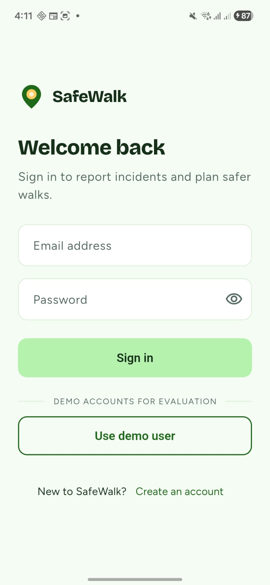
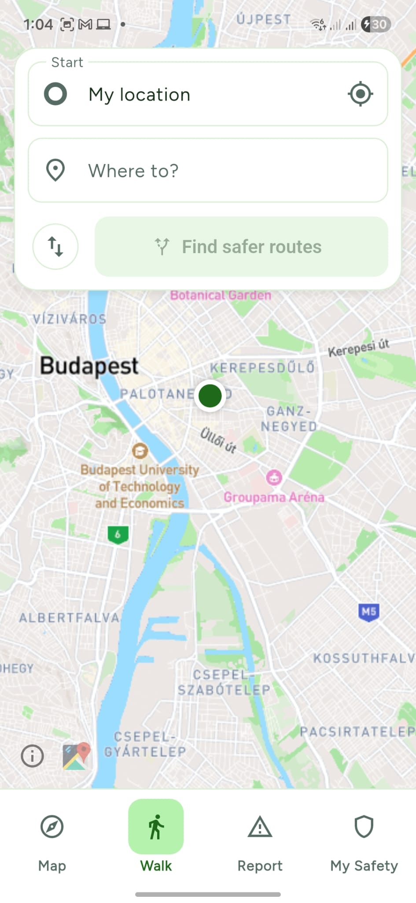
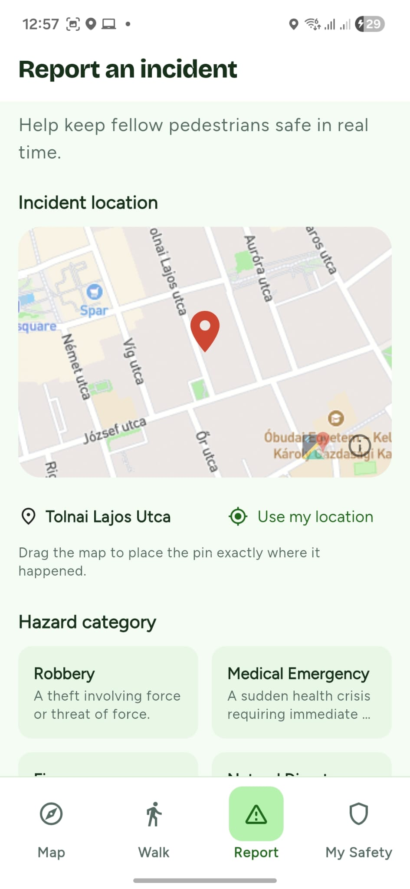
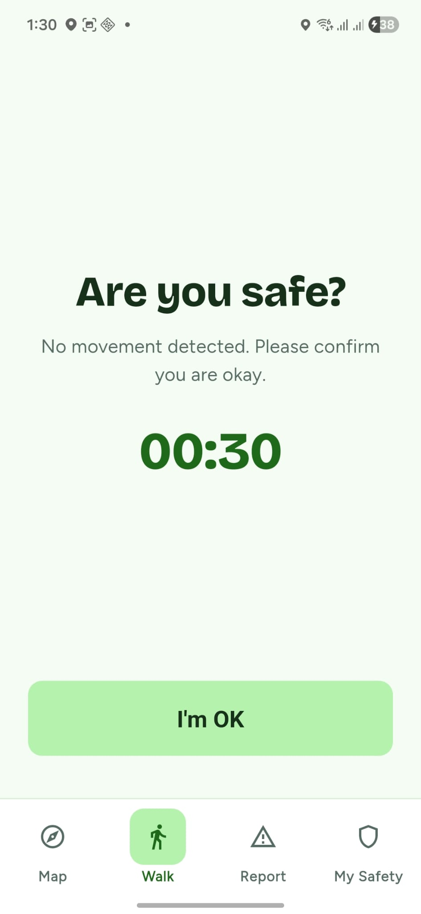

# SafeWalk mobile (Flutter, Android)

Companion app to the SafeWalk web client. Same backend, same design tokens.

## Screenshots

| | | | |
| --- | --- | --- | --- |
|  |  |  |  |
|  |  |  |  |

## Run on a phone
1. Start the backend on port 8080.
2. Put the phone on the same Wi-Fi as this computer. In `env/dev.json` set `BASE_URL` to this computer's address, e.g. `http://192.168.1.71:8080` (see `ipconfig`; allow port 8080 through Windows Firewall on private networks). The USB cable is only needed to install the app. If the cable is stable you can instead use `http://127.0.0.1:8080` plus `adb reverse tcp:8080 tcp:8080` (the forward is lost whenever USB reconnects).
3. Copy `env/dev.example.json` to `env/dev.json` and fill in the Mapbox token (and demo logins if you want the quick-login buttons).
4. `flutter run --dart-define-from-file=env/dev.json`

`env/*.json` is gitignored. Debug builds allow plain http to localhost; release builds do not.

## Release build
`flutter build apk --release --dart-define-from-file=env/prod.json` (a `prod.json` with the real `BASE_URL` over https). Release builds refuse plain http. Signing keys are not in this repo.

## Checks
`flutter analyze` and `flutter test`

## Structure
`lib/core` shared infrastructure (config, network, storage, theme, router, widgets), `lib/features/<name>` one folder per feature.
